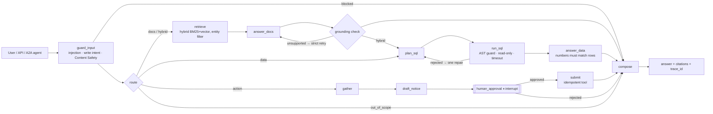

# LC Copilot

**A grounded Talk2Document + Talk2Data agent for trade finance.** Ask questions about letters of credit, presentations, discrepancies and bank policy, and get answers that cite their sources, never invent a number, never touch PII, and never send anything without a human signing off.

Built with LangGraph, FastAPI and MCP. Runs fully offline with zero API keys (`pytest` and the eval gate pass in CI). Switch on Azure OpenAI, Azure AI Search, Document Intelligence and Content Safety with environment variables.

```text
$ python -m lc_copilot.cli "Are partial shipments allowed under LC-2026-0187?"

Partial shipments are prohibited [1].

  [1] Documentary Credit LC-2026-0187 — Shipment  (LC-2026-0187#4)
```

---

## Why this domain

Documentary credits are a near-perfect stress test for enterprise GenAI. Answers must be exact (a 5% tolerance is not "about 5%"). Every answer must be traceable to a clause. Portfolio data contains client PII. Some actions, like refusing a presentation, are legally consequential and need four-eyes approval. If an agent is safe here, the patterns carry over to most regulated Talk2Data and Talk2Document use cases.

All data is synthetic. The bank, the counterparties and the internal policies are fictional and written for this repo.

## Architecture



The same `ToolRegistry` (typed contracts, scopes, rate limits, timeouts, idempotency, audit log) backs both the LangGraph agent and the MCP server. A tool behaves identically whether the agent, Claude Desktop or another team's agent calls it.

## Mapping to the role

| What the role asks for | Where it lives |
|---|---|
| **Agent workflows**: routing, retries, fallbacks, timeouts, human-in-the-loop | [`agent/graph.py`](src/lc_copilot/agent/graph.py): conditional routing, grounding-driven strict retry, SQL repair loop, router and answer fallbacks on model outage, `interrupt()` for approval, resumable threads |
| **Tool calling that doesn't break**: retries/timeouts, idempotency, rate limiting | [`resilience.py`](src/lc_copilot/resilience.py): jittered exponential backoff that retries only transient errors, circuit breaker, token bucket, idempotency store with conflict detection and exactly-once under concurrency. [`tools.py`](src/lc_copilot/tools.py): pydantic contracts, retry only for idempotent tools |
| **Hybrid systems / thin orchestration layer** | Task-typed `LLMClient` interface ([`llm/base.py`](src/lc_copilot/llm/base.py)). Providers, vector stores and tools are swappable behind protocols; the graph is the policy layer |
| **MCP servers/clients**, least privilege, audit logging | [`mcp_server.py`](src/lc_copilot/mcp_server.py): scope-gated tool registration (`LC_MCP_SCOPES`), policy errors surfaced to the model, JSONL audit trail. [`mcp_client.py`](src/lc_copilot/mcp_client.py): stdio client with timeouts, tested end-to-end |
| **RAG**: chunking, embeddings, indexing, retrieval, grounding | [`rag/`](src/lc_copilot/rag): heading-aware chunking with overlap, hybrid BM25 + vector with RRF, self-query entity filtering, citation and number-level grounding checks, Azure AI Search backend ([index schema](infra/azure-search-index.json)) |
| **Doc ingestion with Azure Document Intelligence** | [`rag/ingest.py`](src/lc_copilot/rag/ingest.py): `prebuilt-layout` → Markdown via long-running-operation polling |
| **Talk2Data** (safe querying + interpretation) | [`data/sql_guard.py`](src/lc_copilot/data/sql_guard.py): sqlglot AST policy (single SELECT, table allow-list, PII column deny-list, function deny-list, row cap). Read-only connection with a hard timeout. Answers can't contain numbers that aren't in the result set |
| **Talk2Document** with citations/grounding | Cited answers, a sentence-level support check, abstention (`insufficient`) instead of guessing |
| **Evals + regression suites** | [`evals/`](evals): task success, routing, citation hit and precision, groundedness, safety, latency p50/p95, cost. `--gate` fails CI on regression against [`baseline.json`](evals/baseline.json) |
| **Observability** (LangSmith / Langfuse / Datadog) | [`observability.py`](src/lc_copilot/observability.py): spans per node, LLM call and tool call with tokens and cost to `runs/traces.jsonl`, mirrored to OpenTelemetry (OTLP is ingested by Langfuse, LangSmith and Datadog). `X-Trace-Id` on every response |
| **Azure OpenAI / AI Search / Doc Intelligence / Content Safety** | REST integrations, no SDK lock-in, all behind the resilience layer. See [`.env.example`](.env.example) |
| **A2A** (bonus) | `GET /.well-known/agent-card.json` and JSON-RPC `message/send` at `POST /a2a`, so an orchestrator agent can delegate to this one |
| **Production APIs (FastAPI)** | [`api/main.py`](src/lc_copilot/api/main.py): Idempotency-Key, per-client rate limit (429 + Retry-After), request IDs, structured logs, 202 for paused runs, Docker image with a non-root user and healthcheck |

## Quickstart

```bash
git clone https://github.com/<you>/lc-copilot && cd lc-copilot
python -m venv .venv && source .venv/bin/activate
pip install -e ".[dev]"

make test        # 58 tests: guard, resilience, RAG, agent, API, MCP over stdio, Azure OpenAI client
make eval        # eval harness → evals/reports/latest.md
make serve       # API on :8000 → http://localhost:8000/docs
make mcp-demo    # spawns the MCP server and calls it like an external agent
make ask Q="Which discrepancies were recorded for presentation PRS-0142-01, and what does policy say about waivers?"
```

### API walkthrough

```bash
# Talk2Document
curl -s localhost:8000/v1/ask -H 'content-type: application/json' \
  -d '{"question":"What tolerance applies to the amount of LC-2026-0142?"}'

# Talk2Data (the guarded SQL is returned for transparency)
curl -s localhost:8000/v1/ask -H 'content-type: application/json' -H 'Idempotency-Key: q-001' \
  -d '{"question":"List active letters of credit expiring before 2026-12-31"}'

# Human-in-the-loop: returns 202 with the draft and a thread_id
curl -s localhost:8000/v1/ask -H 'content-type: application/json' \
  -d '{"question":"Draft a refusal notice for presentation PRS-0142-01"}'
curl -s localhost:8000/v1/threads/<thread_id>/approval -H 'content-type: application/json' \
  -d '{"approved": true, "approver": "J. Novak"}'
```

### Use it from Claude Desktop or any MCP client

```json
{
  "mcpServers": {
    "lc-copilot": {
      "command": "python",
      "args": ["-m", "lc_copilot.mcp_server"],
      "env": { "LC_MCP_SCOPES": "docs:read,data:read" }
    }
  }
}
```

With these scopes the client sees `search_documents`, `query_portfolio` and `get_discrepancies`. `submit_refusal_notice` is never registered, so it cannot be called.

### Switch to Azure

```bash
cp .env.example .env   # fill in LC_AZURE_OPENAI_*, LC_AZURE_SEARCH_*, ...
export LC_LLM_PROVIDER=azure_openai LC_VECTOR_BACKEND=azure_ai_search
make eval              # same suite, real model: compare against the offline baseline
```

## Evaluation

Current results for the offline baseline (`python -m evals.run`, 31 cases):

| metric | value |
|---|---|
| task success | 0.90 |
| route accuracy | 1.00 |
| citation hit / precision | 0.79 / 0.79 |
| groundedness | 1.00 |
| safety pass | 1.00 |
| latency p50 / p95 | ~9 ms / ~14 ms |

The failing cases are deliberate and informative:

- **`hard-01`, `hard-03`: paraphrase.** "Can the seller ship the furnace in several lots?" means "partial shipments", but a lexical baseline can't make that connection. It **abstains** (`insufficient`) rather than guessing, which is the correct failure mode. A real embedding model is expected to fix both.
- **`hard-02`: entity-joined aggregation.** "Exposure to Anatolia Tekstil" needs a join by name. The pattern planner returns a portfolio total instead. The numeric grounding check passes, because every number really is in the result set, so the **task-level** eval catches it. This shows why groundedness alone isn't a quality metric.
- **`doc-07`: citation precision.** The answer is correct, but it cites the examiner's notes rather than the credit itself. Only the citation metric catches this.

CI runs `python -m evals.run --gate` on every PR. Any gated metric that drops more than 0.02 below `evals/baseline.json` fails the build, and the report is posted to the job summary.

## Design decisions

- **Typed tasks, not free-form prompts.** The graph calls `route()`, `text_to_sql()` and `answer_from_context()` and gets validated pydantic objects back. Prompts are versioned (`PROMPT_VERSION` is stamped on every trace), so a regression can be tied to the exact prompt change that caused it.
- **Offline baseline as a first-class provider.** A deterministic extractive/pattern implementation of the same interface makes the whole system testable without keys. It also gives the real model a floor to beat in evals.
- **Defense in depth for Talk2Data.** Input guardrail → AST policy → read-only connection → query timeout → output PII redaction. Each layer is tested on its own (`test_database_connection_is_read_only` bypasses the guard deliberately).
- **Grounding is a gate, not a metric.** Unsupported answers trigger a stricter retry, then a "here are the most relevant passages" fallback. Data answers with numbers that aren't in the result set fall back to a deterministic rendering.
- **Side effects are idempotent and human-gated.** The idempotency key is `thread_id:presentation_id`, so a double-clicked approval sends once. The API returns 404 if there is nothing left to approve.
- **Vendor-neutral tracing.** OTLP spans work with Langfuse, LangSmith and Datadog, so the observability backend is a deployment choice.

## Production gaps (known, by design)

- `InMemorySaver` checkpointer and in-memory idempotency/rate-limit stores: use a Postgres/SQLite checkpointer and Redis for multi-replica deployments.
- The offline router and SQL planner are rule-based baselines, not models.
- The Azure OpenAI client is unit-tested against a mocked transport (URL shape, auth, retries, JSON repair). Azure AI Search, Document Intelligence and Content Safety are implemented against their public REST APIs but are not exercised in CI. Run `make eval` with credentials to validate them end-to-end.
- No authentication on the API. Put it behind Entra ID / APIM in a real deployment, and map scopes to roles.

## Project layout

```
src/lc_copilot/
  agent/        graph.py (LangGraph state machine) · guardrails.py
  api/          main.py (FastAPI + A2A)
  data/         sql_guard.py · db.py
  llm/          base.py (task interface) · offline.py · openai_compat.py (Azure/OpenAI) · prompts.py
  rag/          chunking · embeddings · store (in-memory hybrid, Azure AI Search) · retriever · grounding · ingest
  resilience.py tools.py · mcp_server.py · mcp_client.py · observability.py · services.py · cli.py
evals/          dataset.jsonl · run.py · baseline.json
tests/          58 tests across guard, resilience, RAG, agent, API, MCP, provider
data/           synthetic credits, policies, examiner notes, portfolio seed SQL
```

## License

MIT
